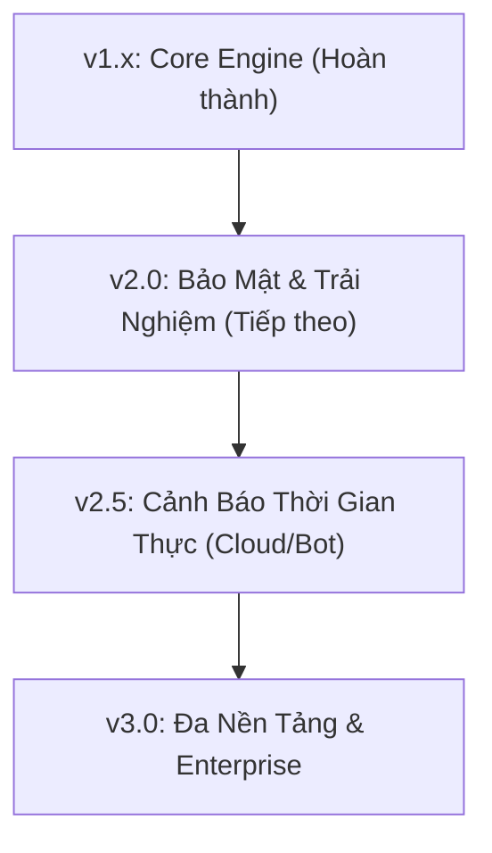

# 🗺️ Lộ Trình Phát Triển & Tầm Nhìn Dự Án (Roadmap & Scaling Vision)

Dự án **USB Monitor & Logger** được định hướng phát triển từ một công cụ giám sát nội bộ (Portable Utility) trở thành một giải pháp **Kiểm toán & Điều tra thiết bị lưu trữ di động (USB Audit & Forensics Platform)** hoàn chỉnh, nhẹ, bảo mật và mở rộng linh hoạt.

---

## 📌 Các Giai Đoạn Phát Triển



---

### GIAI ĐOẠN 1: CORE ENGINE (ĐÃ HOÀN THÀNH - v1.2.0)
- [x] **Zero-Polling Engine:** Chuyển đổi 100% sang Win32 API `kernel32.ReadDirectoryChangesW` (tiêu thụ 0.0% CPU, độ trễ microsecond).
- [x] **VeraCrypt Dynamic Tracking:** Tự động phát hiện container mount/unmount và giám sát I/O bên trong phân vùng mã hóa.
- [x] **Smart Debounce & Batching:** Tự động gom nhóm các thao tác copy hàng loạt (> 8 items) thành 1 dòng tóm tắt.
- [x] **Folder-only ASCII Tree:** Tự động tạo snapshot cây thư mục `root.txt`.
- [x] **Clipboard Out Listener:** Giám sát thao tác copy file từ USB ra máy tính chủ.
- [x] **Cài đặt & Gỡ cài đặt 1-Click:** Script UAC tự động hóa Windows Task Scheduler (`setup_autorun.bat` & `uninstall_autorun.bat`).
- [x] **Portable Standalone Binary:** Đóng gói `.exe` chạy độc lập không cần Python.

---

### GIAI ĐOẠN 2: BẢO MẬT & TRẢI NGHIỆM NGƯỜI DÙNG (KẾ HOẠCH v2.0)

#### 1. Mã Hóa File Nhật Ký (End-to-End Log Encryption)
* **Vấn đề:** Nếu người mượn USB bật chế độ hiển thị file ẩn, họ có thể đọc được file `log_history.txt`.
* **Giải pháp:**
  * Bổ sung tùy chọn mã hóa toàn bộ dữ liệu log bằng thuật toán **AES-256-GCM** hoặc mã hóa bất đối xứng **RSA**.
  * Chỉ chủ sở hữu có Private Key / Mật khẩu mới giải mã được log trên máy tính cá nhân.
  * Người dùng khác chỉ thấy file nhị phân đã mã hóa `.enc`.

#### 2. Local Web Dashboard / Modern GUI Viewer
* Tích hợp giao diện trực quan (HTML5/CSS hiện đại hoặc WebView2 nhẹ) để xem log:
  * **Timeline View:** Xem nhật ký theo dòng thời gian trực quan.
  * **File Filter & Search:** Tìm kiếm theo tên file, dung lượng, định dạng file (`.docx`, `.mp4`, `.zip`...).
  * **Biểu đồ thống kê:** Tần suất cắm USB theo ngày/giờ, biểu đồ dung lượng dữ liệu ra/vào.

#### 3. Băm Checksum File (Forensic Hashing)
* Tự động tính mã băm **SHA-256** của các file quan trọng khi có sự kiện copy ra ngoài (`Out`).
* Giúp chủ sở hữu chứng minh tính toàn vẹn của dữ liệu trong các trường hợp rò rỉ hoặc kiểm tra an ninh số.

---

### GIAI ĐOẠN 3: CẢNH BÁO THỜI GIAN THỰC (KẾ HOẠCH v2.5)

#### 1. Webhook Cảnh Báo (Telegram Bot / Discord / Webhook)
* Khi máy tính có kết nối Internet:
  * Tự động gửi tin nhắn thông báo về **Telegram Bot** hoặc **Discord Channel** của chủ sở hữu mỗi khi USB được cắm vào một máy tính mới.
  * Cảnh báo đỏ ngay lập tức khi phát hiện hành vi bất thường:
    * Sao chép số lượng lớn tài liệu nhạy cảm ra ngoài máy.
    * Xóa hoặc sửa đổi file container VeraCrypt (`Private.hc`).
    * Cố tình can thiệp vào thư mục hệ thống `USB_Log`.

#### 2. Thu Thập Metadata Máy Chủ (Host Footprinting)
* Ghi nhận thông tin cơ bản về môi trường máy chủ cắm USB:
  * Computer Name, Username hiện tại.
  * Windows OS Version, Domain / Workgroup.
  * Địa chỉ IP công cộng (Public IP) và nhà mạng (ISP) nếu có mạng.

---

### GIAI ĐOẠN 4: ĐA NỀN TẢNG & MỞ RỘNG DOANH NGHIỆP (KẾ HOẠCH v3.0)

#### 1. Hỗ Trợ Đa Nền Tảng (Cross-Platform)
* **Linux:** Tích hợp `inotify` và `udev rule` để tự động kích hoạt daemon giám sát khi cắm USB vào hệ điều hành Linux (Ubuntu, Debian, Fedora, Arch).
* **macOS:** Tích hợp `FSEvents` API và `launchd daemon` cho các thiết bị Apple Mac.

#### 2. Cấu Hình Linh Hoạt (Configuration Profile)
* File `config.json` hoặc `config.ini` cho phép người dùng tùy biến:
  ```json
  {
    "debounce_seconds": 1.5,
    "batch_threshold": 8,
    "stealth_mode": true,
    "encrypted_logs": true,
    "ignored_extensions": [".tmp", ".crdownload"],
    "alerts": {
      "telegram_enabled": false,
      "bot_token": "",
      "chat_id": ""
    }
  }
  ```

#### 3. Tùy Chọn Biên Dịch Native C++ / Rust
* Phiên bản biên dịch native bằng C++ hoặc Rust để thu nhỏ kích thước file chạy từ 8.5MB xuống còn **< 1.5MB**, thời gian khởi động 0ms và mức tiêu thụ RAM dưới **5MB**.

---

## 🤝 Đóng Góp & Phản Hồi
Dự án hoan nghênh mọi đóng góp (Pull Requests, Feature Requests, Bug Reports) từ cộng đồng mã nguồn mở. Vui lòng mở Issue trên GitHub để cùng thảo luận!
